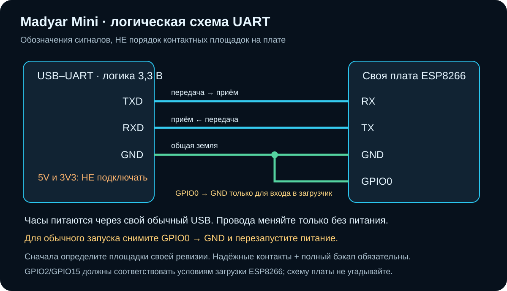

# Madyar Mini · часы, которые показывают работу ИИ

**Разработано Егором совместно с ИИ-помощником Codex от OpenAI.** Автор и инициатор проекта — [Егор / egorcagood](https://github.com/egorcagood).

**Экспериментальный публичный выпуск 0.1.1-preview, исходники.** Для GeekMagic SmallTV-Ultra: ESP8266/ESP-12F, 4 MiB flash, ST7789 240×240 и Windows. Это не официальная прошивка GeekMagic и не продукт OpenAI.

Обычные настольные часы превращаются в индикатор Codex: фирменный экран с вращающейся M, погодой, настоящим остатком лимита и состояниями отдельных чатов. ПК передаёт данные по локальному Wi-Fi; при выключенном/спящем ПК актуальных данных от него нет.

## Начните здесь

1. [Пошаговая инструкция: проверка платы → бэкап → сборка → запуск](docs/START_HERE.ru.md).
2. [Подробности сборки прошивки и адресов flash](firmware/README.md).
3. [Настройка службы и плагина Codex](RUNTIME_SETUP.md).

## Что умеет

- Главный экран: время/дата, погода и ощущения, вращающаяся M, процент оставшегося лимита и время до сброса, когда источник их предоставляет.
- WORKING — работа; WARNING — требуется действие; короткий «Ответ готов» после обычного хода; DONE — только явно подтверждённое завершение задачи. Конец ответа не равен окончанию задачи.
- Независимый учёт чатов и ходов: до 8 зарегистрированных чатов, защита от дубликатов инструментов и устаревших событий. При защищённом переполнении — диагностика, а не ложный Ready.
- Локальная панель, ручное превью, палитра/яркость, контроль перезапуска службы и обновление источников после обнаруженного пробуждения.
- Новые локальные чаты подключаются через установленные hooks. Обычный ChatGPT на телефоне сам по себе источником не является. Названия чатов задаются вручную; переписка для них не читается.

Первый публичный комплект не включает установленный Windows-пакет перехвата Telegram. Служба содержит интерфейс уведомлений, но приём из Windows требует отдельного помощника/разрешений. Не обещаем его работу из этой загрузки.

## Почему здесь нет готового firmware.bin

Ключ управления уникален для владельца и встраивается при сборке. Готовый бинарник с личным ключом нельзя безопасно раздать всем. Инструмент `firmware/tools/provision.py` создаёт **ваш собственный** ключ; затем вы локально собираете приложение и LittleFS. Собранные образы, конфиги, бэкапы и локальные журналы намеренно исключены из Git.

Ни личные адреса устройства, ни Wi-Fi пароли, токены, переписки и заводские дампы автора в комплект не входят. Публичный шрифт — Noto Sans Bold с OFL; M и три утверждённых GIF сохранены. Это исходники для самостоятельной сборки, не установщик «одной кнопкой».

## Важное перед прошивкой

Похожие корпуса могут содержать другую плату. Подтвердите микроконтроллер, flash и распиновку своей ревизии. До любой записи нужен полный бэкап **своих** часов и рабочий путь UART-восстановления. Случайный контакт проводов и 5-вольтовый UART могут повредить устройство. Без бэкапа возврат к заводскому состоянию может быть невозможен. Прошивка — на ваш риск; совместимость со всеми SmallTV не проверена.

Управление устройством и службой не выставляйте в интернет. Погода запрашивается у Open-Meteo, лимиты — через установленный локальный Codex runtime; для свежих данных источникам нужен доступ к своим провайдерам.

## Разработка и лицензии

Код проекта и предоставленные проектом рисунки/анимации — MIT, кроме компонентов с отдельными лицензиями. Noto Sans и производный локальный bitmap-шрифт — OFL-1.1; текст лицензии приложен. Сторонние библиотеки загружаются при сборке и сохраняют свои лицензии: [THIRD_PARTY.md](THIRD_PARTY.md).

Референс раннего исследования управления: [MacheteFlow/GeekMagic-AI-Status](https://github.com/MacheteFlow/GeekMagic-AI-Status). Дамп производителя не распространяется.
